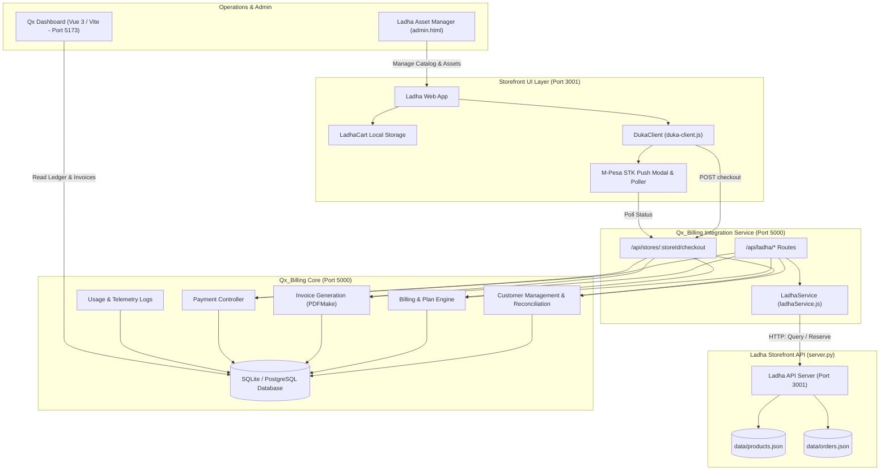

# SYSTEM ARCHITECTURE — LADHA & QX BILLING INTEGRATION

## 1. Executive Summary

This architecture unites the **Ladha** luxury Kenyan archival streetwear storefront with the **Qx_Billing** enterprise billing and ledger engine. The goal is to provide a single coherent platform where e-commerce customer transactions natively feed into a double-entry ledger, generate compliant PDF invoices, record inventory telemetry, and handle multi-channel payments (M-Pesa STK Push and COD).

---

## 2. Component Architecture



---

## 3. Subtle Nuances & Compatibility Logic

To ensure smooth interoperability between a **curated 1-of-1 vintage streetwear storefront** and an **enterprise telecommunications billing engine**, the following domain nuances have been reconciled:

### Nuance 1: 1-of-1 Archival Pieces vs. Telecom Plans & Quantities
- **The Nuance**:
  - `Qx_Billing` defaults to recurring subscription plans or variable consumption (minutes, megabytes, SMS).
  - `Ladha` deals exclusively in **1-of-1 archival vintage garments** (unique pieces sourced from Nairobi vintage bales, e.g. Gikomba/Toi). Once a piece is bought, its stock is permanently `0`.
- **The Compatibility Logic**:
  - **Stock Reservation Hook**: Before generating a bill, `Qx_Billing` calls `POST /api/products/:id/stock` on Ladha with `{ inStock: false, reason: "CHECKOUT_RESERVED" }`.
  - **Automated Rollback**: If the customer cancels the M-Pesa STK push or the request times out, `Qx_Billing` automatically calls `POST /api/products/:id/stock` with `{ inStock: true }`, returning the garment to the live shop.
  - **Catalog Sync**: `POST /api/ladha/sync-catalog` maps each vintage piece into a Qx_Billing `Plan` entity under the `VINTAGE_ARCHIVE` category so reports and invoice line items have correct titles and prices.

### Nuance 2: Kenyan E.164 Phone Normalization & Customer Unification
- **The Nuance**:
  - Shoppers in Nairobi enter phone numbers inconsistently: `0712345678`, `0112345678` (Airtel), `+254 712 345 678`, or `254712345678`.
  - Without normalization, returning shoppers create duplicate records in `Qx_Billing.Customer`.
- **The Compatibility Logic**:
  - `ladhaService.normalizePhone()` strips all non-numeric characters and converts prefixes to standard Kenyan E.164 (`2547XXXXXXXX` or `2541XXXXXXXX`).
  - `Customer.findOrCreate()` looks up existing accounts by normalized phone number, unifying the customer's purchase history, credit, and invoice ledger.

### Nuance 3: Nairobi Regional Delivery Tariffs vs. Flat Invoicing
- **The Nuance**:
  - Retail e-commerce in Kenya requires regional courier delivery fees based on Nairobi zones and upcountry travel.
- **The Compatibility Logic**:
  - `ladhaService.calculateShippingFee()` inspects the customer's delivery estate/address:
    - CBD / Downtown: **KES 200**
    - Kilimani / Westlands / Lavington: **KES 250**
    - Greater Nairobi (Ruaka, Thika Rd, Rongai): **KES 400**
    - Upcountry (Mombasa, Kisumu, Nakuru, Eldoret): **KES 500**
  - Delivery is isolated into an explicit line item on the generated `Bill` and `Invoice` rather than being blended into the item price.

### Nuance 4: Direct API Bridge (Qx_Billing -> Ladha)
- **The Nuance**:
  - The two systems run as decoupled microservices (`Ladha` on port 3001, `Qx_Billing` on port 5000).
- **The Compatibility Logic**:
  - `billing/backend/services/ladhaService.js` provides HTTP client methods:
    - `getProducts()`: queries Ladha's live catalog.
    - `getProduct(id)`: checks availability and vintage measurements.
    - `reserveItem(id, ref)`: locks piece during checkout.
    - `releaseItem(id, ref)`: unlocks piece on failed payment.
    - `recordOrder(order)`: registers finalized order with M-Pesa receipt in Ladha's order store.

---

## 4. API Specification for Qx_Billing to Ladha Bridge

| Method | Endpoint | Caller | Handler | Description |
|---|---|---|---|---|
| `GET` | `/api/ladha/health` | Client / Qx Admin | Qx Billing -> Ladha | Checks bidirectional health connectivity. |
| `GET` | `/api/ladha/products` | Qx Billing | Qx Billing -> Ladha API | Pulls the active garment catalog from Ladha. |
| `POST` | `/api/ladha/sync-catalog` | Qx Admin | Qx Billing Core | Reconciles Ladha garments into Qx_Billing plans. |
| `POST` | `/api/ladha/checkout` | Ladha UI / Client | Qx Billing Core | Reserves items in Ladha, creates Customer, Bill, and Invoice. |
| `POST` | `/api/ladha/simulate-payment` | Developer / STK Webhook | Qx Billing Core | Approves/cancels STK prompt with automatic stock rollback. |
| `GET` | `/api/ladha/orders` | Qx Admin / Ladha Admin | Qx Billing + Ladha API | Returns unified order ledger from both databases. |

---

## 5. Directory Structure in Unified Workspace

```
Storefront/
├── storefront/              # Ladha Headless Storefront & API Server
│   ├── index.html           # Editorial Homepage
│   ├── shop.html            # Garment Catalog
│   ├── checkout.html        # M-Pesa STK Push Checkout
│   ├── server.py            # Multithreaded Python API Server (Port 3001)
│   ├── data/
│   │   ├── products.json    # Persistent Garment Catalog
│   │   └── orders.json      # Persistent Order Repository
│   ├── js/
│   │   ├── duka-client.js   # Commerce Client SDK
│   │   └── store-db.js      # Unified Store DB with API Sync
│   └── css/style.css        # Swiss Brutalist Design System
│
├── billing/                 # Qx_Billing Platform
│   ├── backend/             # Express.js Core (Port 5000)
│   │   ├── server.js        # Main server mounting /api/ladha
│   │   ├── services/
│   │   │   └── ladhaService.js # HTTP Client talking to Ladha API
│   │   ├── routes/
│   │   │   ├── ladha.routes.js # Ladha Commerce & Inventory Bridge
│   │   │   └── duka.routes.js  # Headless Checkout Gateway
│   │   └── models/          # Sequelize Ledger & Billing Models
│   └── frontend/            # Vue 3 Dashboard (Port 5173)
│
├── scripts/
│   └── start-dev.js         # Concurrent Dev Server Launcher
├── ARCHITECTURE.md          # Architectural Specification
├── README.md                # Quickstart & Developer Guide
└── package.json             # Root NPM Scripts
```
